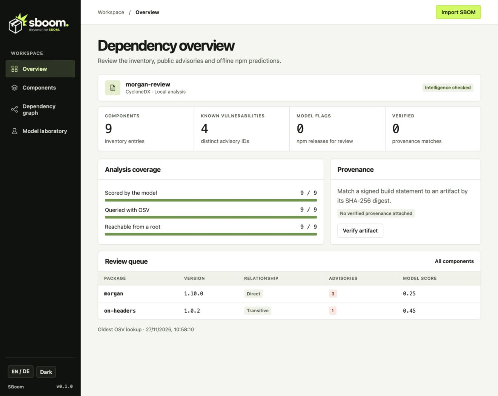
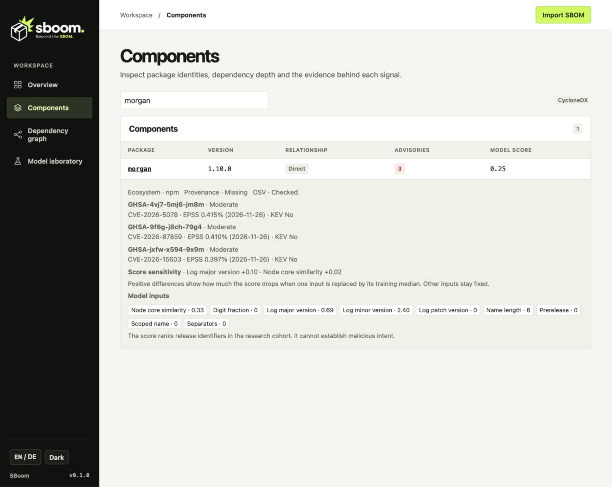
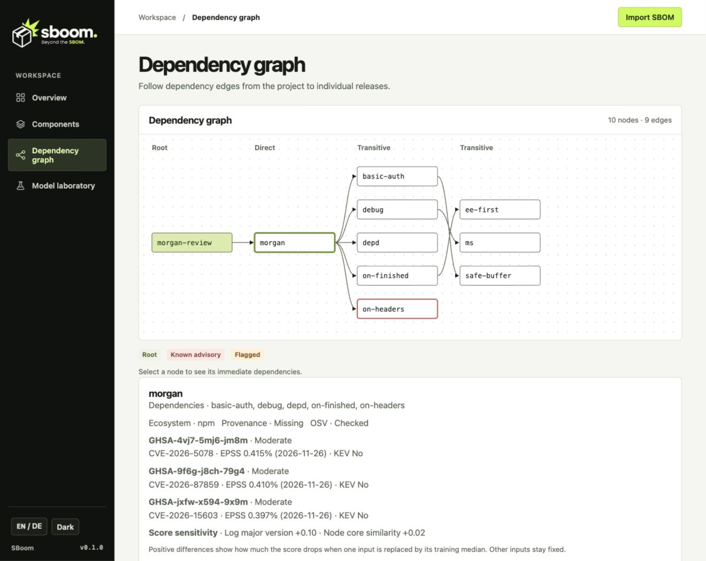
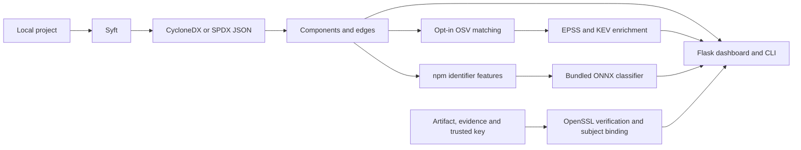
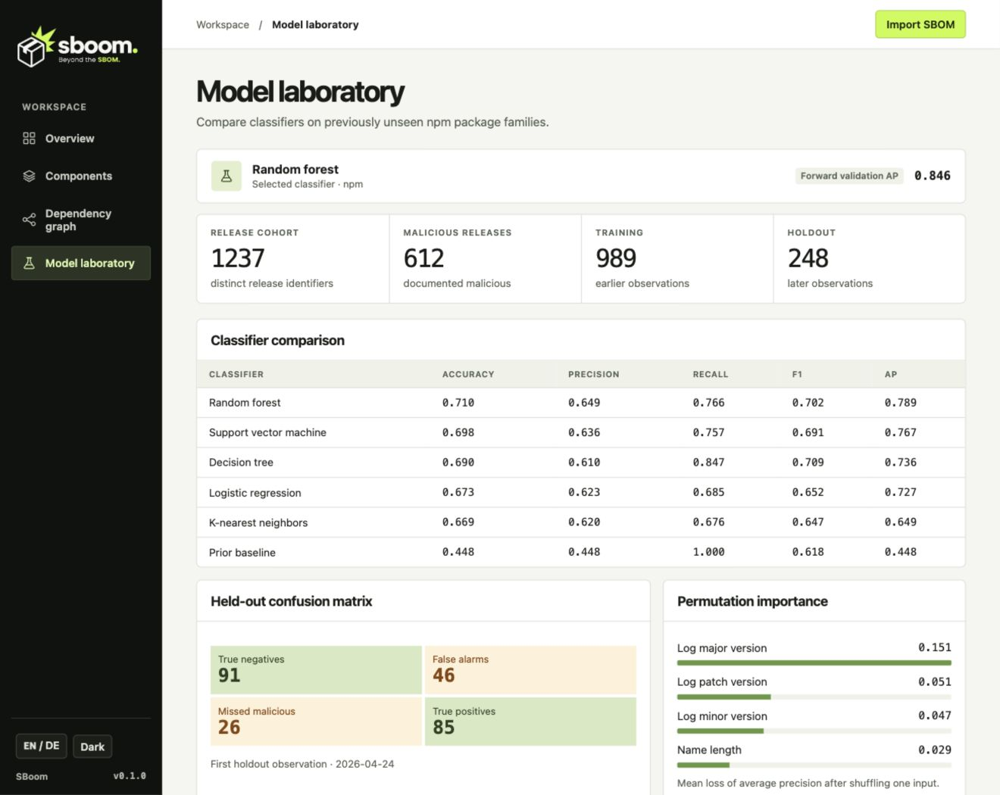

<p align="center"></p>

# SBoom

A local workbench for reviewing software bills of materials. Load two releases to see which dependencies changed, inspect their advisories, and follow their edges through the graph. An offline classifier can flag an npm release even when it has no published advisory.

[Quick start](#quick-start) · [Model results](#model-results) · [Notebook](ml/sboom.ipynb) · [Kurz auf Deutsch](#kurz-auf-deutsch)



## Quick start

With Docker Compose installed, run the following from a terminal.

```sh
git clone https://github.com/yacrb/sboom.git
cd sboom
docker compose up --build -d
```

Open [localhost:8765](http://localhost:8765), choose **Import SBOM**, then **Open example**. The example is a real CycloneDX inventory generated by npm from a lockfile containing morgan 1.10.0. To compare your own releases, select the current file and expand **Compare releases** to supply the earlier one. Use `docker compose down` to stop the app.

Analysis starts offline. Choosing online lookup sends package names, ecosystems and versions to OSV. SBoom sends CVE identifiers to FIRST and downloads the public CISA catalog. Source files, complete SBOM documents, prediction inputs and uploaded artifacts stay on your machine. The server binds to loopback through Compose. The application holds a report in browser memory until the page reloads.

### Command line

For the native CLI, use Python 3.11 or later in a virtual environment and run `python -m pip install .` from the repository. Native scans require Syft on PATH. Docker includes Syft and OpenSSL.

```sh
sboom analyze web/example.json
sboom analyze web/example.json --online
sboom scan . --output-sbom inventory.cdx.json
sboom compare old.cdx.json new.cdx.json
sboom verify artifact --key trusted-public.pem --attestation provenance.dsse.json
sboom verify artifact --key trusted-public.pem --signature artifact.sig
sboom dashboard --project /path/to/project
```

The same CLI runs in Docker. Mount only the directory you intend to inspect. For example, run a scan from inside a project after building the Compose image.

```sh
docker run --rm -v "$PWD:/project:ro" sboom-sboom scan /project
```

To enable the dashboard's **Scan project** button in Docker, stop the default service and run the command below. The result includes a **Save generated SBOM** control.

```sh
docker run --rm -p 127.0.0.1:8765:8765 -v "$PWD:/project:ro" \
  sboom-sboom dashboard --project /project
```

## What the evidence means

| Evidence | What SBoom checks |
| --- | --- |
| Inventory | CycloneDX JSON and SPDX 2.x JSON package records. Package URLs identify ecosystems. Explicit relationships supply edges and shortest distance from a declared root. Missing roots leave depth unknown. |
| Public advisories | OSV matches for versioned npm, PyPI, Maven, Go, Cargo, RubyGems, NuGet and Composer identities. Other components remain visible. Advisory details include available severity, CVE aliases, EPSS and KEV status. Reported malicious packages have a separate label. |
| Model flags | An npm name and a supported semantic version supply nine numeric inputs. A flag puts the component in the review queue. Component details show how the score changes when individual inputs move to their training medians. |
| Artifact verification | OpenSSL verifies detached RSA PKCS#1 v1.5/SHA-256 signatures or a DSSE envelope with an in-toto Statement v1 and SLSA provenance v1 predicate. Supply an independently trusted public key. SBoom checks the signature and SHA-256 subject digest, and displays the declared builder. An inventory component receives verified provenance only when its SHA-256 matches. |
| Coverage | Offline, unsupported and unavailable lookups remain visible. OSV responses use an in-process hourly cache. At most 100 unique advisory records receive detail enrichment per analysis. Pagination or omitted details produce partial coverage. EPSS or KEV outages yield unknown values. |

Plain statements can be inspected. Missing evidence, invalid evidence and unsupported formats have distinct outcomes. A detached artifact signature alone provides no build history. The verifier does not certify a builder's trustworthiness, assign a SLSA level, or verify keyless Sigstore bundles. The web request limit is 12 MiB, with up to 5,000 components and 50,000 unique edges. The graph displays up to 60 connected nodes.

| Component evidence | Dependency graph |
| --- | --- |
| [](assets/screenshots/components.jpg) | [](assets/screenshots/graph.jpg) |



## Model results

The cohort contains **612 documented malicious-intent releases and 625 presumed-benign comparisons**. Positives come from the pinned Datadog npm sample index. Controls come from twelve dated npm CLI and VS Code lockfile snapshots, excluding names in the pinned Datadog and OpenSSF indexes. SBoom reads filenames and registry metadata without downloading training packages. The two control projects cover development tools, application libraries and their dependencies. They represent a narrow slice of npm. [Datadog dataset](https://github.com/DataDog/malicious-software-packages-dataset) · [OpenSSF reports](https://github.com/ossf/malicious-packages) · [Collection code and exact revisions](ml/dataset.py)

The inputs are name length, fraction of digits, separator count, scope, similarity to a fixed list of Node core modules, log-transformed major/minor/patch versions, and prerelease status. These survive takedowns and can be reconstructed from an SBOM. Historical maintainer counts, install scripts, popularity and provenance were unavailable consistently across both cohorts. Advisory IDs, collection dates and repository origin never enter the feature vector.

Three expanding training windows selected the random forest by mean average precision (AP). The first 989 observations formed the training set. The 248 held-out observations start on April 24, 2026. Dates represent discovery or lockfile observation. One release per normalized family and one positive per discovery day reduce repetition. Unidentified campaigns can span days and naming patterns.

| Classifier | CV AP | Accuracy | Precision | Recall | F1 | ROC-AUC | Test AP |
| --- | ---: | ---: | ---: | ---: | ---: | ---: | ---: |
| Prior baseline | .554 | .448 | .448 | 1.000 | .618 | .500 | .448 |
| Logistic regression | .762 | .673 | .623 | .685 | .652 | .763 | .727 |
| K-nearest neighbors | .758 | .669 | .620 | .676 | .647 | .727 | .649 |
| Decision tree | .770 | .690 | .610 | .847 | .709 | .771 | .736 |
| **Random forest** | **.846** | **.710** | **.649** | **.766** | **.702** | **.814** | **.789** |
| Support vector machine | .823 | .698 | .636 | .757 | .691 | .794 | .767 |

The forest flagged **85 of 111** documented malicious releases and **46 of 137** controls. Its Brier score was **0.182**, versus **0.251** for the prior baseline. Numeric scores reflect this selected cohort. A score of 0.8 cannot be interpreted as an 80% probability of malware across npm. On a separate positive-only probe of 1,419 previously unseen-family releases from Datadog's compromised-library index, 903 were flagged (63.6%). This probe cannot estimate false positives. [Full benchmark](ml/benchmark.json)

A separate course exercise predicts days until the next stable release using npm and deps.dev timestamps. Multiple linear regression had a mean absolute error of **11.63 days** on 423 later observations. The training-median baseline did better at **10.86 days**. This forecast is confined to the notebook. [npm registry](https://registry.npmjs.org/) · [Open Source Insights](https://deps.dev/)

[](assets/screenshots/laboratory.jpg)

### Reproduce the experiment

Use Python 3.12 and Git. The first run needs internet access and space for the public metadata cache. The notebook performs exploration, validation, calibration and confusion plots, holdout inference checks and the separate regression exercise. Run it in a disposable checkout if you want to keep the supplied model intact. Training writes a new ONNX model and benchmark in `ml/`.

```sh
python -m venv .venv
. .venv/bin/activate
python -m pip install -e '.[research,test]'
jupyter nbconvert --to notebook --execute ml/sboom.ipynb --output /tmp/sboom-executed.ipynb
python -m pytest -q
```

The classifier sources use pinned Git objects. Regression uses public release histories filtered through September 30, 2026, so upstream corrections can change that experiment. The table above describes the bundled model. An independent Linux retrain used the same dataset fingerprint and selected the same classifier, with 47 false alarms and 26 misses at the default threshold. Generated tables and caches stay under the ignored `ml/data/` directory. [Open the notebook in Colab](https://colab.research.google.com/github/yacrb/sboom/blob/main/ml/sboom.ipynb)

## Contributing

A small SBOM that demonstrates a parsing problem, an advisory mismatch or a reproducible false positive makes a good issue. Remove private package names and paths before sharing. For a pull request, describe the input and expected result, add a focused regression test and run `python -m pytest -q`. Model changes should report both missed releases and false alarms against the same split. SBoom is licensed under [Apache 2.0](LICENSE).

## Kurz auf Deutsch

SBoom analysiert Softwarestücklisten lokal. Importieren Sie eine CycloneDX- oder SPDX-Datei, vergleichen Sie zwei Releases und verfolgen Sie direkte und transitive Abhängigkeiten im Graphen. Öffentliche Sicherheitshinweise werden auf Wunsch bei OSV abgefragt und mit EPSS und dem KEV-Katalog ergänzt. Das npm-Modell liefert Hinweise für die manuelle Prüfung. Fehlende Provenienz ist kein Beweis für ein bösartiges Paket.

Starten Sie SBoom mit `docker compose up --build -d`, öffnen Sie [localhost:8765](http://localhost:8765) und wählen Sie **EN / DE**. Im Modelllabor sehen Sie die echten Testergebnisse und die Grenzen des Verfahrens. [Deutsches Modelllabor im dunklen Design](assets/screenshots/labor-de.jpg)
